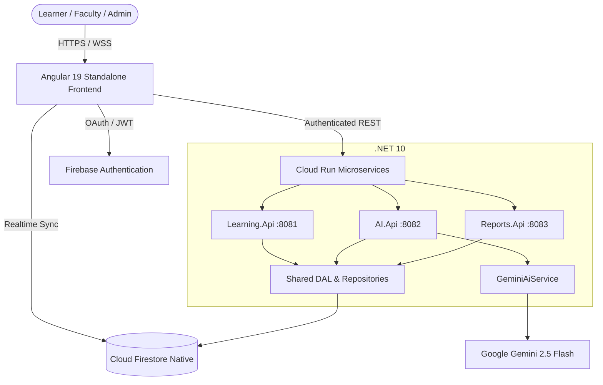

# HackHive Learning Studio

An enterprise-grade edutech learning platform built for the **AI Builder Cup JAPAC**, powered by **Google Firebase**, **Cloud Run** (.NET 10 microservices), and **Google Gemini 2.5** for adaptive, real-world skill building.

---

## 🌐 Live Deployment

- **Production URL**: [https://aibuildercup2026-26b22.web.app](https://aibuildercup2026-26b22.web.app)
- **Firebase Project Console**: [Firebase Console](https://console.firebase.google.com/project/aibuildercup2026-26b22/overview)
- **Deployment Tier**: 100% Free via Firebase Spark Plan (Hosting, Firestore Native, and Authentication)

---

## 🚀 Key Features & Multi-Role Workspaces

HackHive features role-tailored workspaces that dynamically adapt to the user's identity:

### 🎓 Student Workspace
- **Overview & Telemetry**: Visual learning streak tracker, progress gauge, competency radar map, and weekly activity chart.
- **Personalized Gemini Learning Paths**: Dynamic, multi-lesson curricula calibrated to learner goals and recent assessment benchmarks.
- **Adaptive Knowledge Checks**: Interactive multiple-choice quizzes with verified server-side scoring and Gemini-generated feedback.
- **Progress Synchronization**: Real-time Firestore sync of completed modules, quiz records, and pace benchmarks.

### 👩‍🏫 Teacher Workspace
- **Cohort Pulse**: Live cohort size, active weekly learner count, cohort completion percentage, and student roster.
- **Curriculum Manager**: Inspection and management of assigned courses, difficulty levels, and lesson allocations.
- **Assessment Review**: Gradebook breakdown, pass/review status, and topic accuracy analytics.
- **Classroom Reports**: Comparative benchmark analytics against platform averages.

### 🛡️ Administrator Workspace
- **Platform Health**: Real-time status indicators for Cloud Run microservices (`Learning.Api`, `AI.Api`, `Reports.Api`), Firestore Native connectivity, and Gemini API quotas.
- **Course Catalog CRUD**: Full Create, Read, Update, and Delete capabilities for courses with instant Firestore persistence.
- **User Directory & Governance**: Member registry with interactive role assignment (`student` ↔ `teacher` ↔ `admin`).
- **AI Telemetry & Analytics**: Model performance, response latency percentiles, and fallback resilience metrics.

---

## 🏗️ Architecture & Clean Data Access Layer (DAL)



### Clean Architecture Components
- **`backend/Shared/Repositories/`**:
  - `ILearningRepository` & `FirestoreLearningRepository`: Course catalog CRUD, learning path state, and lesson progress.
  - `IAssessmentRepository` & `FirestoreAssessmentRepository`: Quiz creation with server-held private answer keys and verified scoring.
  - `IReportRepository` & `FirestoreReportRepository`: Aggregate calculations for personal and cohort benchmarks.
  - `IUserRepository` & `FirestoreUserRepository`: Profile creation, directory queries, and role governance.
- **`backend/Shared/Services/`**:
  - `IGeminiAiService` & `GeminiAiService`: LLM generation with `CleanJsonFences` Markdown sanitization, prompt calibration, and a pedagogical fallback generator ensuring 100% uptime.
- **`backend/Services/`**:
  - `Learning.Api`: Course catalog and progress endpoints using repository injection.
  - `AI.Api`: Gemini learning paths, adaptive quiz engine, and feedback endpoints.
  - `Reports.Api`: Personal benchmark summaries, cohort aggregates, and user administration.

---

## 🧪 Automated Test Suite (24/24 Passing)

The project includes automated test suites covering all modules, DAL repositories, AI resilience, and frontend components:

### 1. Frontend Test Suite (Angular & Karma Headless Chrome)
```powershell
cd frontend
npm run test:ci
```
**Results**:
- `12/12 tests passed` (initialization, role switching, Google Sign-In & OAuth modal, Gemini learning path, interactive lesson modal, quiz submission, course catalog CRUD, user role management, contact form submission with Firestore sync, sign out).

### 2. Backend Test Suite (.NET 10 & xUnit)
```powershell
dotnet test backend/Tests/HackHive.Tests.csproj
```
**Results**:
- `14/14 tests passed` (Gemini JSON fence stripping, adaptive score calibration, quiz question constraints, feedback tone, domain model contracts).

---

## 💻 Run Locally

### Requirements
- **Node.js**: v20 or newer
- **.NET SDK**: 10.0 or newer

### 1. Start the Frontend
```powershell
cd frontend
npm ci
npm start
```
Open [http://localhost:4200](http://localhost:4200). Sign in as **Student**, **Teacher**, or **Administrator**, or test OAuth sign-in.

### 2. Build Backend Microservices
```powershell
dotnet build backend/Services/Learning.Api/Learning.Api.csproj -c Release
dotnet build backend/Services/AI.Api/AI.Api.csproj -c Release
dotnet build backend/Services/Reports.Api/Reports.Api.csproj -c Release
```

### 3. Run Backend Microservices
Set environment variables:
- `FIREBASE_PROJECT_ID`: `aibuildercup2026-26b22`
- `WEB_ORIGIN`: `http://localhost:4200`
- `GEMINI_API_KEY`: *(Optional, adaptive fallback activates when omitted)*

```powershell
dotnet run --project backend/Services/Learning.Api/Learning.Api.csproj --urls "http://localhost:8081"
dotnet run --project backend/Services/AI.Api/AI.Api.csproj --urls "http://localhost:8082"
dotnet run --project backend/Services/Reports.Api/Reports.Api.csproj --urls "http://localhost:8083"
```

---

## 📦 Deployment

### Deploy to Firebase Hosting & Firestore
```powershell
# Build Angular production bundle
cd frontend
npm run build
cd ..

# Deploy Hosting, Firestore rules, and indexes
firebase deploy --only hosting,firestore:rules,firestore:indexes --project aibuildercup2026-26b22
```

### GitHub Actions CI/CD Pipeline
The workflow in [`.github/workflows/ci-cd.yml`](.github/workflows/ci-cd.yml) automatically:
1. Validates Node dependencies and runs Angular frontend flow tests (`npm run test:ci`).
2. Builds all three .NET microservices and executes the xUnit backend test suite (`dotnet test`).
3. Builds container images and deploys microservices to **Google Cloud Run**.
4. Deploys production bundle and security rules to **Firebase Hosting & Cloud Firestore**.